# RiskLens

Fraud and transaction risk analytics on a public synthetic card-transaction dataset (13.3M rows). A DuckDB warehouse, a calibrated LightGBM risk model, a FastAPI backend and a Next.js dashboard with ten pages: executive overview, transaction explorer, fraud analytics, risk scoring, model lab, explainability, exposure scenarios, monitoring, case management and reports.

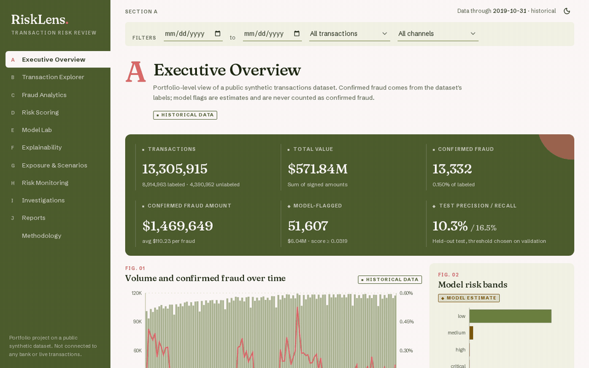

A longer MP4 of the same walkthrough is in [docs/demo.mp4](docs/demo.mp4). It is a screen capture of the real app running locally on the full dataset, nothing mocked.

## What it does
- **Warehouse**: raw CSV/JSON to DuckDB with leakage-safe features (client and card history computed from earlier rows only). Card numbers, CVVs and addresses are dropped.
- **Model**: temporal split, LightGBM plus a logistic regression baseline, isotonic calibration, threshold chosen on validation, test period scored once.
- **Dashboard**: server-side filtering and pagination over all 13.3M rows, per-transaction explanations, adjustable risk bands, threshold explorer, what-if scoring, drift and data-quality monitoring, case workflow, CSV export and a printable report.
- Every page is tagged **Historical**, **Model** or **Simulated** so facts, estimates and assumptions are never mixed.

## Results (held-out test, 2018-07 to 2019-10, 2,246 frauds, base rate 0.18%)
| Model | PR-AUC | ROC-AUC | Precision | Recall |
|---|---|---|---|---|
| Logistic regression (baseline) | 0.0067 | 0.709 | 1.3% | 10.6% |
| LightGBM, calibrated | 0.0511 | 0.886 | 10.3% | 16.5% |

These numbers are modest and shown as they are. Quarterly PR-AUC ranges from 0.027 to 0.155. Top drivers by mean |SHAP|: mcc, new_merchant_for_client, is_online, use_chip, merchant_state. See [docs/limitations.md](docs/limitations.md) for what this does and does not show.

## Screenshots
Captured from the running app (full 13.3M-row dataset, local). Desktop 1440 px wide.

| | |
|---|---|
| 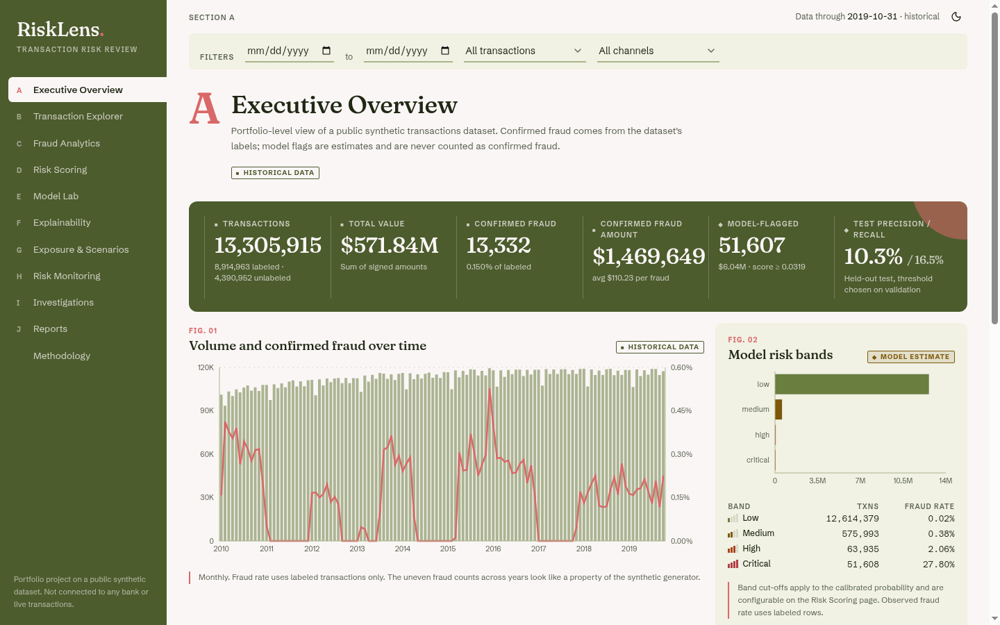 | 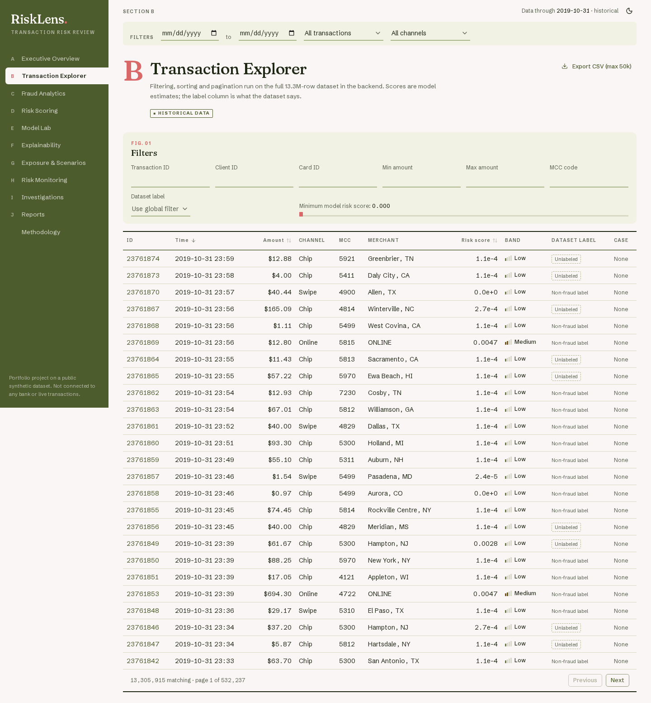 |
| 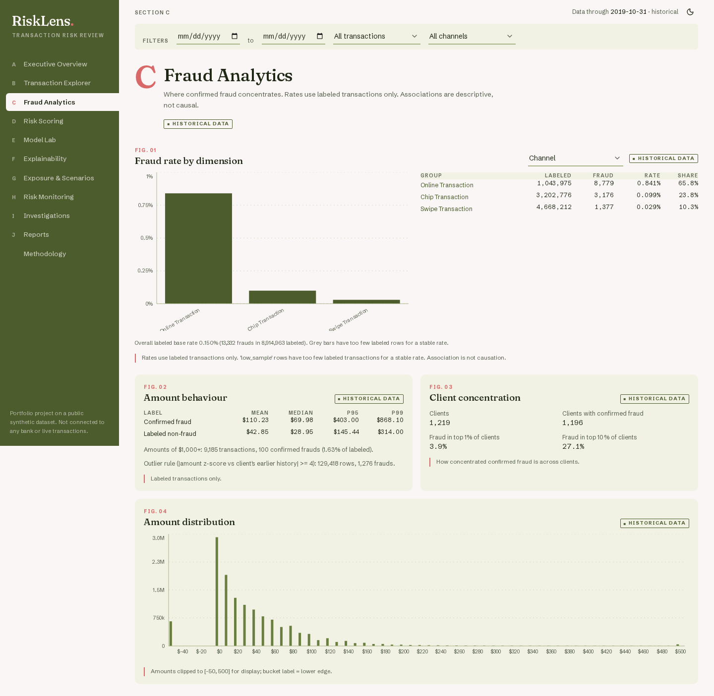 | 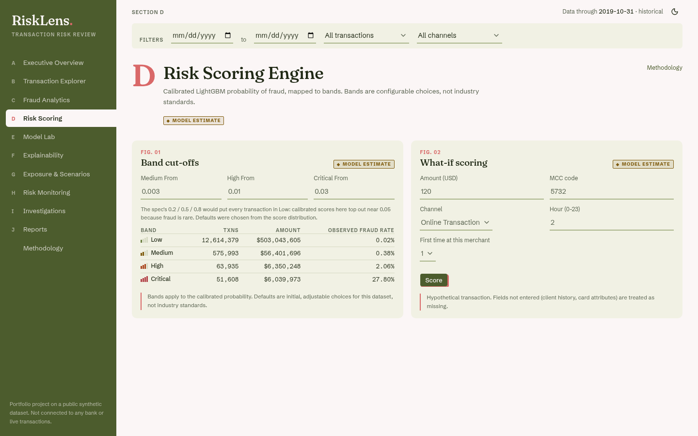 |
| 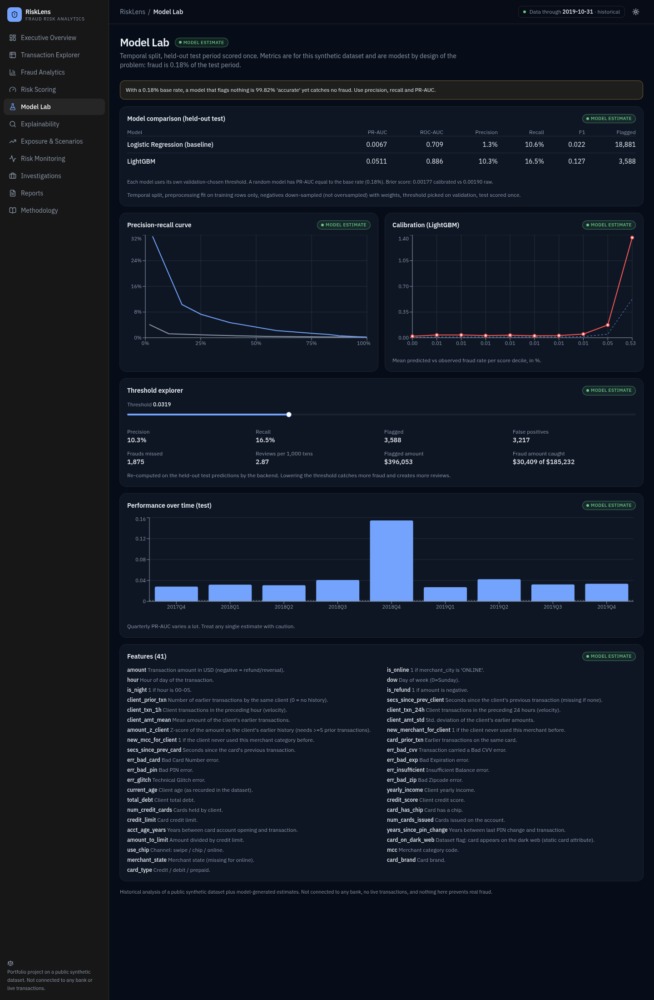 | 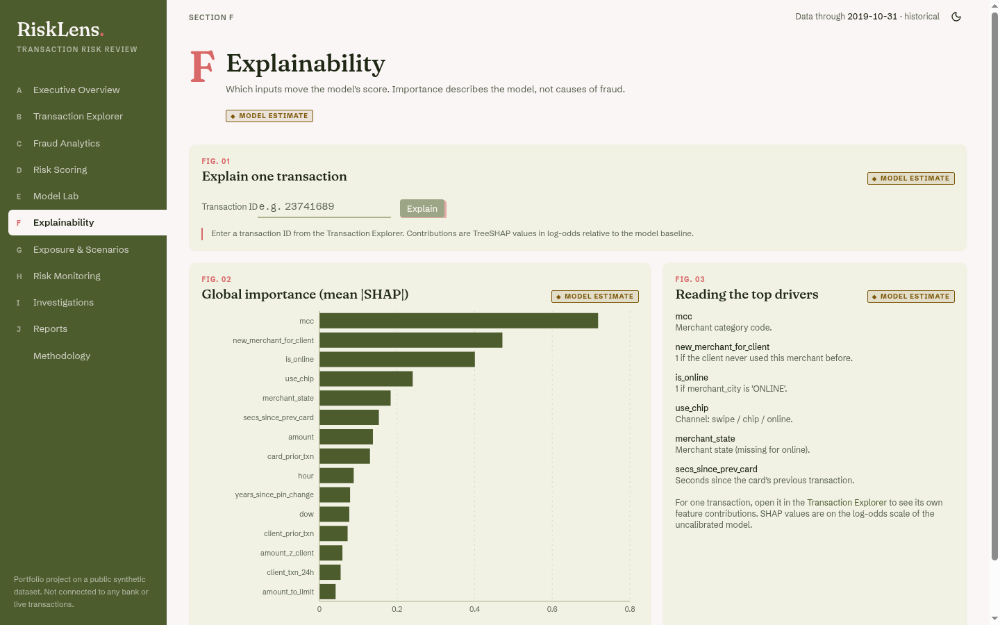 |
| 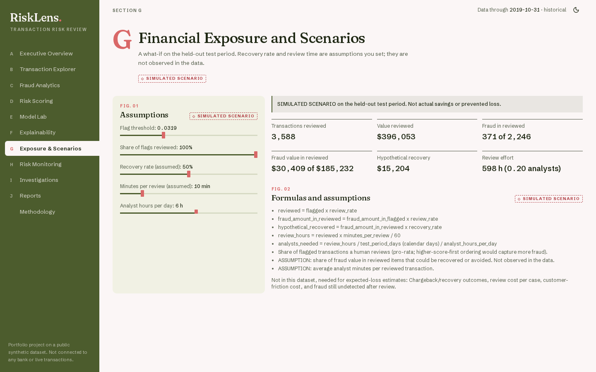 | 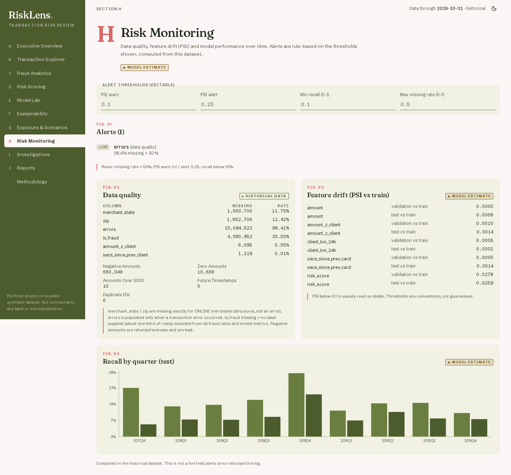 |
| 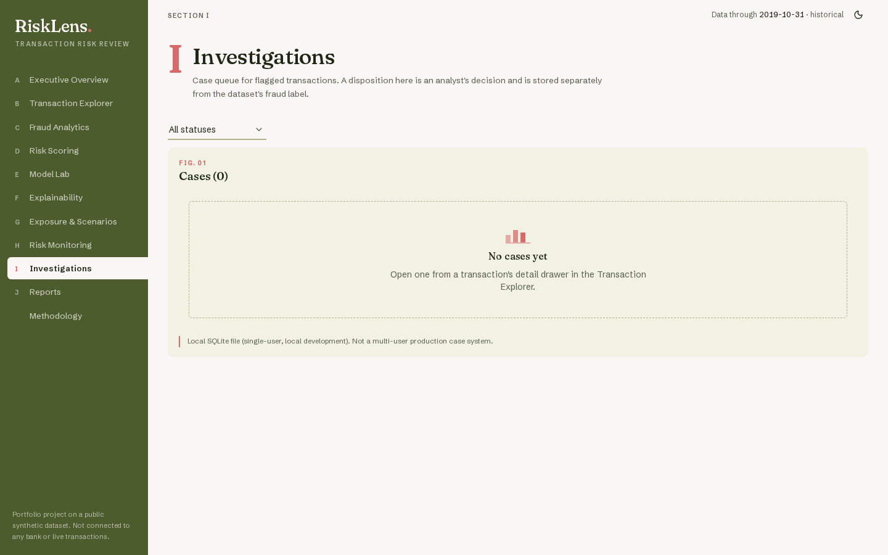 | 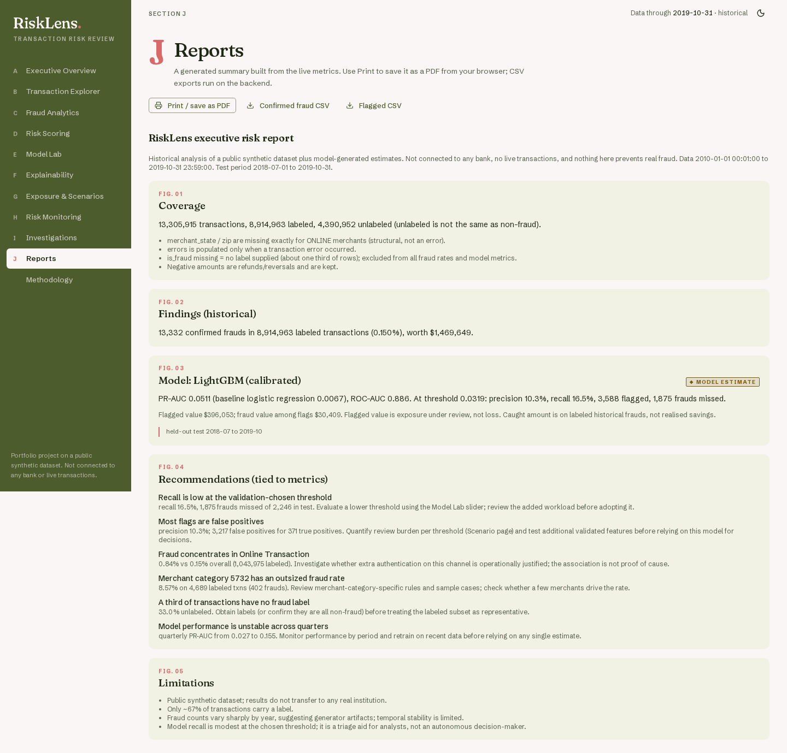 |

Mobile (390 px): [overview](docs/screenshots/mobile-overview.png), [model lab](docs/screenshots/mobile-model-lab.png). Methodology page: [screenshot](docs/screenshots/methodology.png).


## Dataset
The files in `data/` match the Kaggle dataset ["Financial Transactions Dataset: Analytics"](https://www.kaggle.com/datasets/computingvictor/transactions-fraud-datasets) (synthetic card transactions, 2010-2019). Download it from Kaggle and put these five files in `data/`: `transactions_data.csv` (about 1.2 GB), `users_data.csv`, `cards_data.csv`, `mcc_codes.json`, `train_fraud_labels.json` (about 150 MB). The dataset is not in this repo (size and licence), and the raw files are never modified. Card numbers, CVVs and addresses are dropped when the warehouse is built.

## Run locally
Requirements:
- Python 3.10+ and Node 20+.
- RAM: measured on this build, the API uses about 840 MB right after start-up and about 1.1 GB at peak (DuckDB is capped at 700 MB by default; set `RISKLENS_DUCKDB_MEMORY` to change it for both the build and the API). Plan for 2 GB free. On a 2 GB machine the API was killed once when a browser and heavy analytics ran at the same time.
- Disk: about 2.3 GB for the DuckDB warehouse, on top of the 1.4 GB of raw files.
- Run the heavy steps (build, train, score) one at a time on a small machine.

```bash
# 1. Backend
python3 -m venv .venv && source .venv/bin/activate
pip install -r requirements.txt            # pinned versions: requirements.lock.txt
export RISKLENS_DUCKDB_MEMORY=600MB        # lower (e.g. 250MB) on small machines
python -m backend.pipeline.build_warehouse # build the DuckDB warehouse
python -m backend.models.train             # train, writes backend/artifacts/metrics.json
python -m backend.models.score_all         # write risk scores into the warehouse
python -m pytest backend/tests -q
uvicorn backend.app.main:app --port 8000

# 2. Frontend (new terminal)
cd frontend && cp ../.env.example .env.local   # keep only the NEXT_PUBLIC_API_URL line
npm install
npm run dev                                    # http://localhost:3000
```
Run the heavy steps one at a time on a small machine. See [.env.example](.env.example).

## Limitations (as audited)
- Synthetic data. Test PR-AUC is 0.051, so this is a triage aid, not a detector. Scores before 2017 are in-sample.
- Band defaults are 0.003 / 0.01 / 0.03, not the 0.2 / 0.5 / 0.8 examples in the brief, because calibrated scores top out near 0.05.
- Not built: a server-generated PDF (the report uses the browser's print-to-PDF), drill-down from the hour, weekday and card-brand charts to transactions, and browser end-to-end tests.
- Cases are a single-user local SQLite file with a change history. No login and no multi-user access.
- Tested only in headless Chrome, with no screen-reader walkthrough and no contrast check on the dark theme.
- Chrome plus the full API on a 2 GB machine ran out of memory once (see Run locally). Parallel load was not tested.

## Why there is no live demo link
This is deliberate. The full app needs a 2.3 GB DuckDB file and about 1.2 GB of RAM. Vercel Functions allow a 500 MB Python bundle, 2 GB of memory and a read-only filesystem ([limits](https://vercel.com/docs/functions/limitations)). Render's free web service has 512 MB of RAM and an ephemeral disk ([docs](https://render.com/docs/free)), and Hugging Face Docker Spaces need a paid plan ([docs](https://huggingface.co/docs/hub/en/spaces-overview)). The walkthrough GIF and screenshots above are captured from the real local app instead. The frontend alone is a normal Next.js app and could be deployed with `NEXT_PUBLIC_API_URL` pointing at an API with enough memory.

## Tests
```bash
python -m pytest backend/tests -q      # 18 tests
cd frontend && npm test                # 9 unit tests (formatting, API retry)
cd frontend && npx eslint . && npx tsc --noEmit && npm run build
```

## Docs
[Methodology](docs/methodology.md) · [Data dictionary](docs/data-dictionary.md) · [Architecture and deployment notes](docs/architecture.md) · [Limitations](docs/limitations.md)

## Stack
Next.js 16 (App Router, TypeScript strict), Tailwind, shadcn/ui, Recharts, TanStack Table, Zod; FastAPI, Pydantic, DuckDB, scikit-learn, LightGBM.

## Notes
Portfolio project on synthetic data. Not connected to any bank or live transactions, and not suitable for real fraud decisions.

## License
MIT, see [LICENSE](LICENSE). The dataset is not covered by this license and is not included in the repo.
